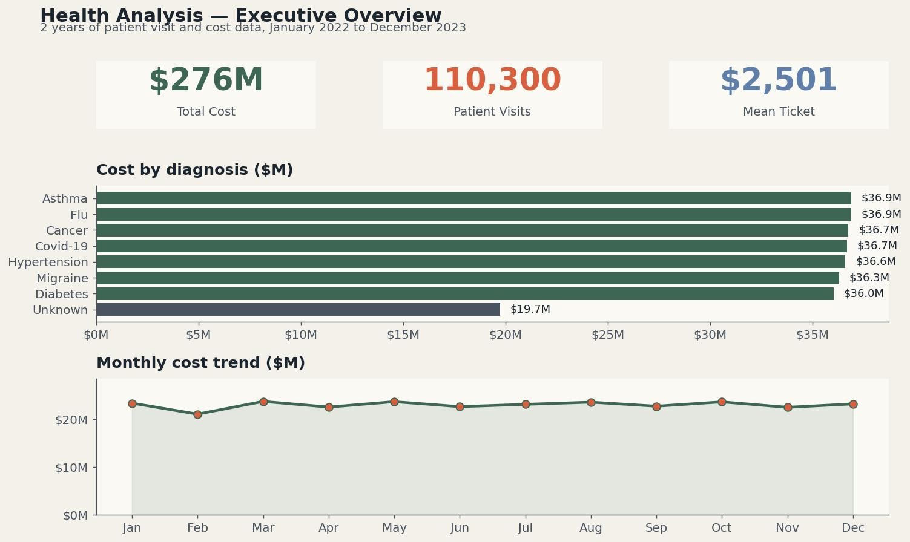
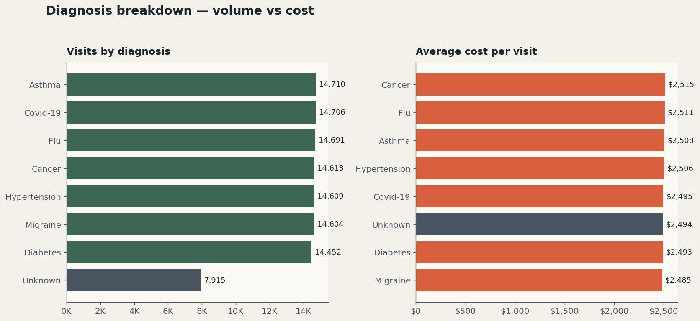
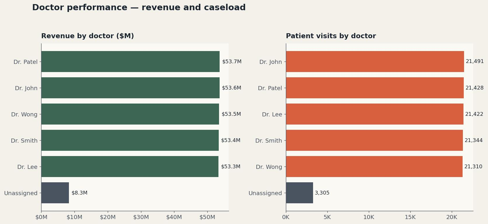
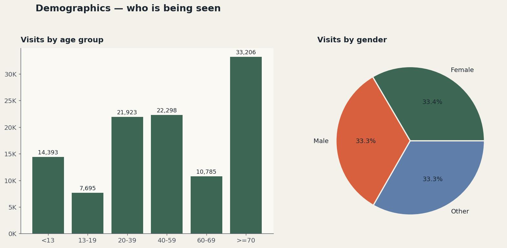
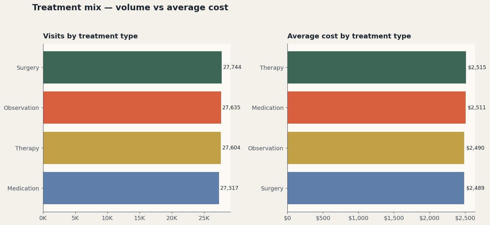
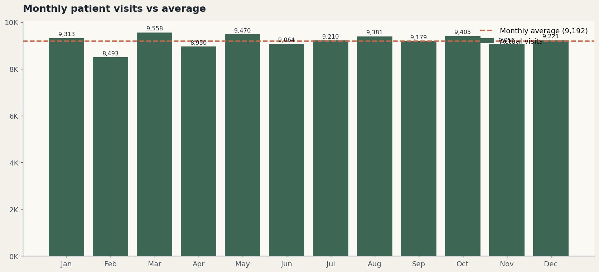

# Health Analysis

**Healthcare data, turned into decisions.**

Two years of patient visit and cost data, cleaned and shaped into an Excel dashboard that surfaces where care money actually goes.



## Quick links

- 🌐 [Open the live workbook on OneDrive](https://1drv.ms/x/c/5c96de2b5cf375c8/IQCf9Vnc81phSYgDGY5OHSUeAbY-MJBSO5USUpMOBcT4EZc?e=3SXhwC)
- 📄 [Read the documentation (PDF)](docs/Health-Analysis-Documentation.pdf)
- 📊 [Download the Excel workbook](workbook/Health_Analysis.xlsx)
- 🎞️ [Editable PowerPoint deck](docs/Health-Analysis-Documentation.pptx)

---

> **A note on GitHub previews.** GitHub renders Markdown, PDFs, and images inline. It does not preview Excel workbooks or PowerPoint files in the browser. For those, GitHub shows a file page with a **Download** button on the top right. This is normal.

---

## Table of Contents

- [About the project](#about-the-project)
- [Headline findings](#headline-findings)
- [Dashboards](#dashboards)
- [Repository structure](#repository-structure)
- [Data dictionary](#data-dictionary)
- [How the workbook is organized](#how-the-workbook-is-organized)
- [Run it locally](#run-it-locally)
- [Key insights](#key-insights)
- [Recommendations](#recommendations)
- [Tech stack](#tech-stack)
- [Limitations](#limitations)
- [License](#license)

---

## About the project

Health Analysis takes 114,000 raw patient visit records and turns them into an answer to one question. *Where is the cost of care actually going?*

The work covers the full BI cycle inside a single Excel workbook:

1. **Cleaning** the raw export into a validated dataset (110,300 rows after dedup and validation)
2. **Modeling** the data with derived fields like Age Group, Month and Cost Tax
3. **Aggregating** through pivot tables across diagnosis, doctor, demographics and time
4. **Visualizing** the results in an interactive dashboard with slicers

The dataset spans January 2022 to December 2023 and tracks 5,000 unique patients across 7 diagnosis categories, 4 treatment types and 5 attending doctors.

---

## Headline findings

| Metric | Value | Note |
|---|---|---|
| Total cost across 2 years | **$276M** | Across 110,300 visits |
| Mean ticket per visit | **$2,501** | Tight variance between diagnoses |
| Patient visits processed | **110,300** | After cleaning 3,700 invalid rows |
| Unique patients seen | **5,000** | Average 22 visits per patient |
| Diagnosis categories | **7** | Plus an Unknown bucket worth $19.7M |
| Largest age cohort | **70+ years** | 33,206 visits, the largest of any group |

---

## Dashboards

Click any image to view full size.

### 1. Executive overview

*Where does the money go in one glance.*


### 2. Diagnosis breakdown

*Volume and ticket size, side by side.*



### 3. Doctor performance

*Caseload and revenue by attending doctor.*



### 4. Demographics

*Who is being seen, by age and gender.*



### 5. Treatment mix

*Visits and average cost by treatment type.*



### 6. Monthly pattern

*Visit volume month by month against the annual average.*



For the full narrative behind each view, see [the documentation PDF](docs/Health-Analysis-Documentation.pdf).

---

## Repository structure

```
health-analysis/
│
├── README.md                                This file
├── LICENSE                                  MIT
├── CONTRIBUTING.md                          Contribution guidelines
├── .gitignore
│
├── docs/
│   ├── Health-Analysis-Documentation.pdf    Renders inline on GitHub
│   ├── Health-Analysis-Documentation.pptx   Editable PowerPoint
│   └── screenshots/                         Dashboard JPGs and hero image
│
└── workbook/
    └── Health_Analysis.xlsx                 The interactive Excel workbook
```

---

## Data dictionary

The cleaned dataset lives in the **Clean Data** sheet of the workbook.

| Column | Type | Description |
|---|---|---|
| `VisitDate` | Date | The date the patient was seen, normalized to ISO format |
| `PatientID` | Text | Unique patient identifier (P0001 to P5000) |
| `Age` | Integer | Patient age in years at visit date |
| `Gender` | Categorical | Female, Male, Other |
| `Diagnosis` | Categorical | One of 7 conditions plus an Unknown bucket |
| `Treatment` | Categorical | Surgery, Therapy, Medication, Observation |
| `Doctor` | Categorical | Attending physician (5 doctors plus an Unassigned bucket) |
| `Cost` | Decimal | Visit cost in USD |
| `Age Group` | Derived | Bucketed age (<13, 13-19, 20-39, 40-59, 60-69, 70+) |
| `Month` | Derived | Three-letter month abbreviation from VisitDate |

---

## How the workbook is organized

The workbook has eight sheets. Each one does one thing.

| Sheet | Purpose |
|---|---|
| `Raw Data` | Original 114,000 row export. Untouched. |
| `Clean Data` | 110,300 row validated dataset. The single source of truth for everything downstream. |
| `Formulas` | Derived columns and worked examples (Cost Tax, Round, Round Up, Age Group categorization) |
| `PivotSrc` | Pivot table over Clean Data for diagnosis-level aggregation |
| `PivotData` | Wider pivot used by the dashboard, includes year and doctor cross-tabs |
| `Analysis` | Standalone doctor revenue summary |
| `Dashboard` | The interactive dashboard with slicers and KPI cards |
| `DashData` | Backing data table that feeds every dashboard chart |

---

## Run it locally

### Option 1: Open the live workbook on OneDrive

[Click here to open the workbook in Excel for the web](https://1drv.ms/x/c/5c96de2b5cf375c8/IQCf9Vnc81phSYgDGY5OHSUeAbY-MJBSO5USUpMOBcT4EZc?e=3SXhwC). No download, no install. The dashboard, slicers and pivot tables work directly in the browser.

### Option 2: Download and open in Excel Desktop

1. Clone or download this repository
2. Open `workbook/Health_Analysis.xlsx` in Microsoft Excel 2016 or later
3. Enable editing if prompted
4. Open the `Dashboard` sheet
5. Use the slicers on the left to filter by Gender, Diagnosis or Month

The workbook is self-contained. No external connections, no Power Query refresh required.

---

## Key insights

1. **Cost spreads almost evenly across named diagnoses.** Six of seven diagnoses cluster in a $36M to $37M band over two years. Resource planning does not need to favour any single disease group.

2. **Unknown diagnosis is the largest data quality gap.** $19.7M of cost sits against unlabelled diagnoses. Fixing intake categorization unlocks visibility into roughly 7 percent of the spend.

3. **Doctor workload is balanced, with one anomaly.** The five named doctors each carry between $53.3M and $53.7M in revenue. The Unassigned bucket holds $8.3M that needs attribution to a real provider.

4. **The 70+ group is the largest patient cohort.** 33,206 visits, the highest of any age bracket. Service capacity should anchor on this group.

5. **Treatment type does not predict cost.** Surgery, Therapy, Medication and Observation all average within $30 of each other per visit. Cost variance lives elsewhere, likely in case volume and underlying complexity.

---

## Recommendations

| Priority | Action | Expected impact |
|---|---|---|
| High | Fix the intake categorization process | Recover visibility into $19.7M of currently unlabelled spend |
| High | Resolve the Unassigned doctor records | Attribute $8.3M of revenue to real providers, improve compensation accuracy |
| Medium | Move from monthly to weekly cost monitoring | Catch cost shifts inside the cycle instead of one month late |
| Medium | Build a doctor-level utilization view | Pair revenue with hours worked, visit counts per shift, and outcomes |
| Low | Validate the 70+ cohort capacity plan | Confirm the schedule, beds and specialist mix match the highest-volume group |

Full discussion in [the documentation PDF](docs/Health-Analysis-Documentation.pdf).

---

## Tech stack

| Layer | Tool |
|---|---|
| Data cleaning | Excel formulas, Power Query |
| Modeling | Pivot tables, derived columns, slicers |
| Visualization | Excel pivot charts, conditional formatting |
| Documentation | PowerPoint (editorial deck), PDF export for inline GitHub preview |

---

## Limitations

- **Source dataset is synthetic.** The patient and cost records are realistic in shape but not from a real clinical system. Treat the insights as a demonstration of the analytical approach, not as clinical fact.
- **The Unknown diagnosis and Unassigned doctor buckets are kept in scope** rather than dropped, because they reflect real data quality issues a working analyst would face. They show up in the totals.
- **Costs are nominal.** No inflation adjustment between 2022 and 2023.

---

## License

Released under the MIT License. See [LICENSE](LICENSE) for details.

---

**Built by Bih Brandy** · Business Intelligence Analyst · Microsoft Fabric and Power BI Specialist

- 🌐 [Live workbook on OneDrive](https://1drv.ms/x/c/5c96de2b5cf375c8/IQCf9Vnc81phSYgDGY5OHSUeAbY-MJBSO5USUpMOBcT4EZc?e=3SXhwC)
- 📄 [Documentation PDF](docs/Health-Analysis-Documentation.pdf)
- 📊 [Excel workbook](workbook/Health_Analysis.xlsx)
- 🎞️ [PowerPoint deck](docs/Health-Analysis-Documentation.pptx)
