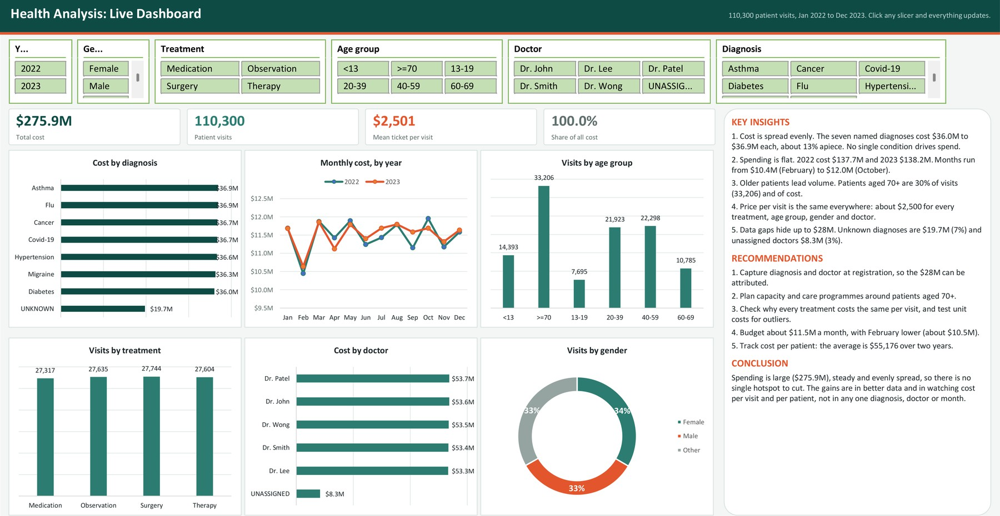
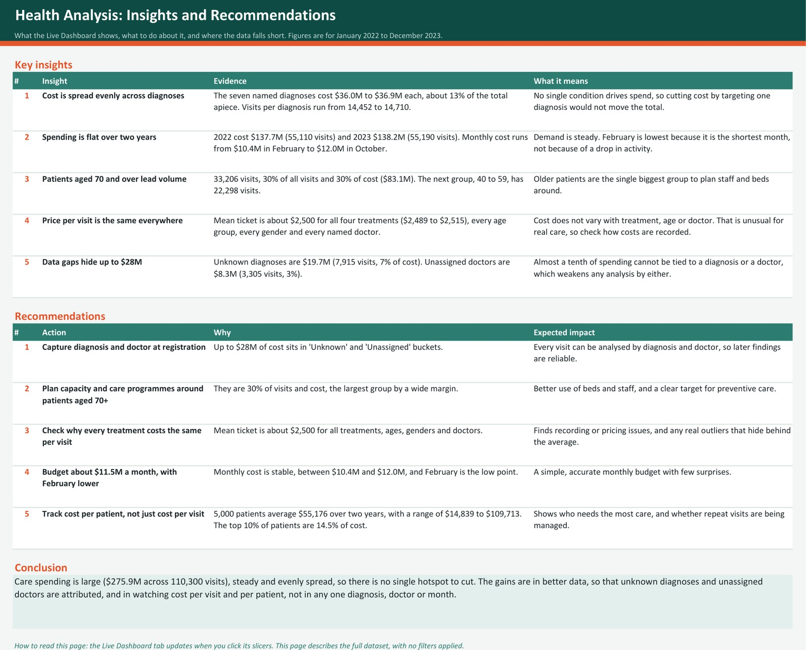
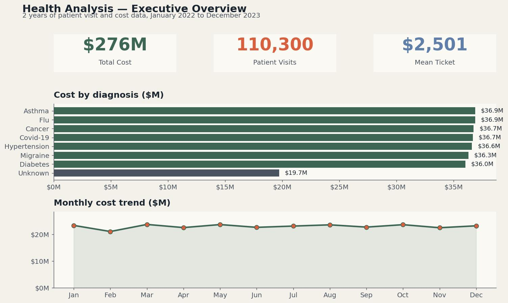
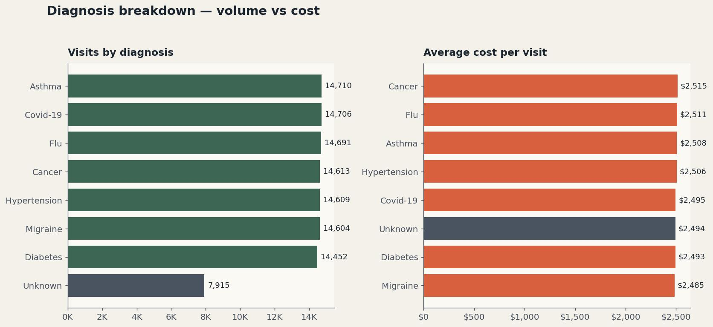
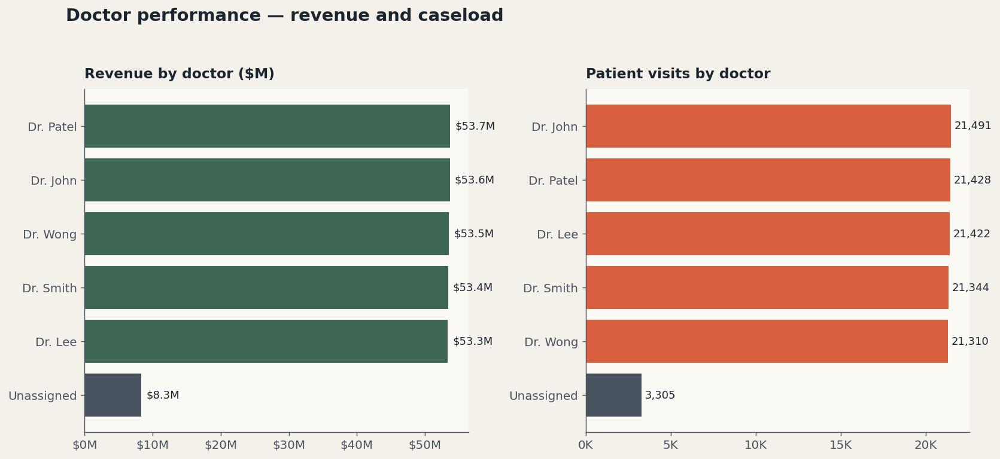
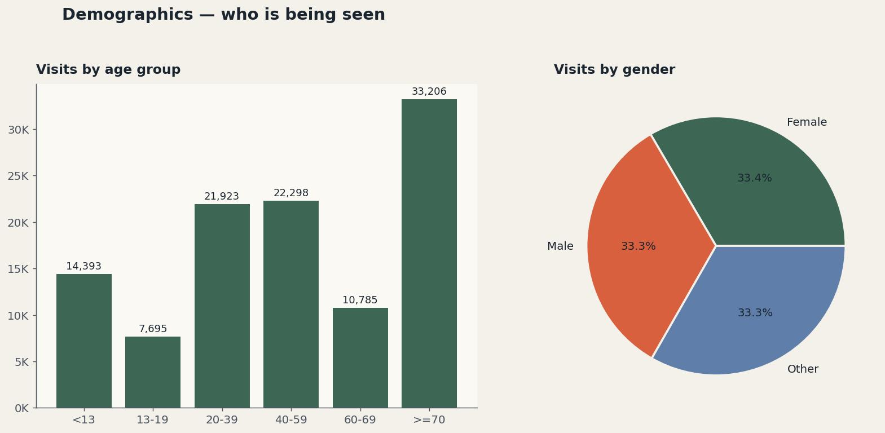
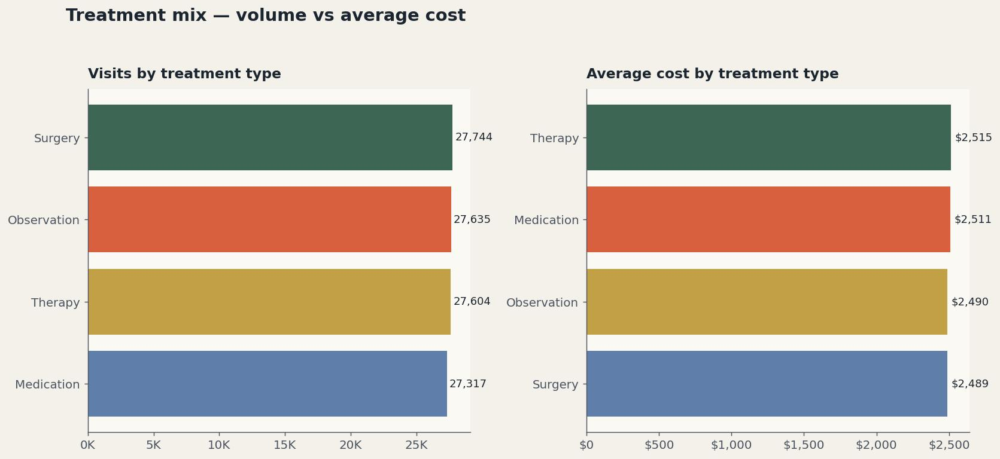
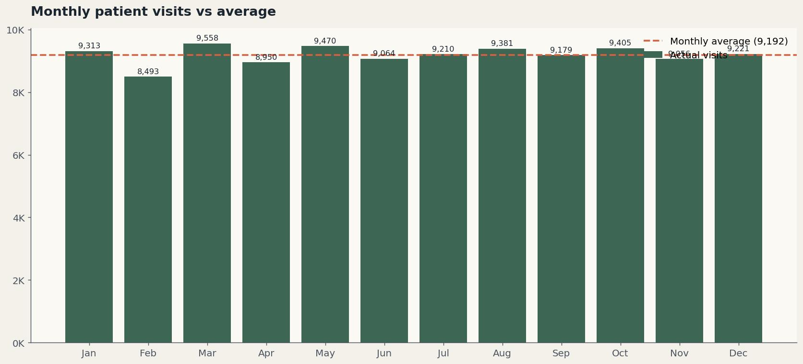

# Health Analysis

**Healthcare data, turned into decisions.**

Two years of patient visit and cost data, cleaned and shaped into a live Excel dashboard. Click a slicer and every number and chart updates.



## Quick links

- 🌐 [Live web dashboard](https://bihbrandysango-cloud.github.io/projects/health/), which runs in any browser, with the six slicers, cost per patient and data quality pages
- 🌐 [Open the earlier workbook on OneDrive, before the live dashboard](https://1drv.ms/x/c/5c96de2b5cf375c8/IQCf9Vnc81phSYgDGY5OHSUeAbY-MJBSO5USUpMOBcT4EZc?e=3SXhwC)
- 📄 [Read the documentation (PDF)](docs/Health-Analysis-Documentation.pdf)
- 📊 [Download the live Excel workbook](workbook/Health_Analysis.xlsx), with a `Live Dashboard` tab and an `Insights` tab
- 🎞️ [Editable PowerPoint deck](docs/Health-Analysis-Documentation.pptx)

---

> **A note on GitHub previews.** GitHub renders Markdown, PDFs, and images inline. It does not preview Excel workbooks or PowerPoint files in the browser. For those, GitHub shows a file page with a **Download** button on the top right. This is normal.

---

## Table of Contents

- [About the project](#about-the-project)
- [Headline findings](#headline-findings)
- [The live dashboard](#the-live-dashboard)
- [Dashboards](#dashboards)
- [Repository structure](#repository-structure)
- [Data dictionary](#data-dictionary)
- [How the workbook is organized](#how-the-workbook-is-organized)
- [Run it locally](#run-it-locally)
- [Key insights](#key-insights)
- [Recommendations](#recommendations)
- [Tech stack](#tech-stack)
- [Limitations](#limitations)
- [License](#license)

---

## About the project

Health Analysis takes 114,000 raw patient visit records and turns them into an answer to one question. *Where is the cost of care actually going?*

The work covers the full BI cycle inside a single Excel workbook:

1. **Cleaning** the raw export into a validated dataset (110,300 rows after dedup and validation)
2. **Modeling** the data with derived fields like Age Group, Month and Cost Tax
3. **Aggregating** through pivot tables across diagnosis, doctor, demographics and time
4. **Visualizing** the results in an interactive dashboard with slicers

The dataset spans January 2022 to December 2023 and tracks 5,000 unique patients across 7 diagnosis categories, 4 treatment types and 5 attending doctors.

---

## Headline findings

| Metric | Value | Note |
|---|---|---|
| Total cost across 2 years | **$276M** | Across 110,300 visits |
| Mean ticket per visit | **$2,501** | Tight variance between diagnoses |
| Patient visits processed | **110,300** | After cleaning 3,700 invalid rows |
| Unique patients seen | **5,000** | Average 22 visits per patient |
| Diagnosis categories | **7** | Plus an Unknown bucket worth $19.7M |
| Largest age cohort | **70+ years** | 33,206 visits, the largest of any group |

---

## The live dashboard

The `Live Dashboard` tab is one screen: six slicers (year, gender, treatment, age group, doctor, diagnosis), four KPI cards, six charts and a panel of insights, recommendations and a conclusion. All six slicers filter the same pivot tables, so every card and chart redraws together.


The `Insights` tab sets out the five insights, the five recommendations and the conclusion in full, with the evidence behind each.



---

## Dashboards

The six views below are from the first version of the dashboard.

Click any image to view full size.

### 1. Executive overview

*Where does the money go in one glance.*



### 2. Diagnosis breakdown

*Volume and ticket size, side by side.*



### 3. Doctor performance

*Caseload and revenue by attending doctor.*



### 4. Demographics

*Who is being seen, by age and gender.*



### 5. Treatment mix

*Visits and average cost by treatment type.*



### 6. Monthly pattern

*Visit volume month by month against the annual average.*



For the full narrative behind each view, see [the documentation PDF](docs/Health-Analysis-Documentation.pdf).

---

## Repository structure

```
health-analysis/
│
├── README.md                                This file
├── LICENSE                                  MIT
├── CONTRIBUTING.md                          Contribution guidelines
├── .gitignore
│
├── docs/
│   ├── Health-Analysis-Documentation.pdf    Renders inline on GitHub
│   ├── Health-Analysis-Documentation.pptx   Editable PowerPoint
│   └── screenshots/                         Dashboard JPGs and hero image
│
└── workbook/
    └── Health_Analysis.xlsx                 The interactive Excel workbook
```

---

## Data dictionary

The cleaned dataset lives in the **Clean Data** sheet of the workbook.

| Column | Type | Description |
|---|---|---|
| `VisitDate` | Date | The date the patient was seen, normalized to ISO format |
| `PatientID` | Text | Unique patient identifier (P0001 to P5000) |
| `Age` | Integer | Patient age in years at visit date |
| `Gender` | Categorical | Female, Male, Other |
| `Diagnosis` | Categorical | One of 7 conditions plus an Unknown bucket |
| `Treatment` | Categorical | Surgery, Therapy, Medication, Observation |
| `Doctor` | Categorical | Attending physician (5 doctors plus an Unassigned bucket) |
| `Cost` | Decimal | Visit cost in USD |
| `Age Group` | Derived | Bucketed age (<13, 13-19, 20-39, 40-59, 60-69, 70+) |
| `Month` | Derived | Three-letter month abbreviation from VisitDate |
| `Year` | Derived | Year from VisitDate (2022 or 2023), added for the live dashboard |
| `MonthNo` | Derived | Month number from VisitDate, added for the live dashboard |

---

## How the workbook is organized

The workbook has eleven sheets. Each one does one thing.

| Sheet | Purpose |
|---|---|
| `Live Dashboard` | The one-screen live dashboard: slicers, KPI cards, pivot charts and the insights panel. |
| `Insights` | Key insights, recommendations and conclusion, with the evidence for each. |
| `Live Data` | The pivot tables behind the live dashboard. Do not edit. |
| `Raw Data` | Original 114,000 row export. Untouched. |
| `Clean Data` | 110,300 row validated dataset. The single source of truth for everything downstream. |
| `Formulas` | Derived columns and worked examples (Cost Tax, Round, Round Up, Age Group categorization) |
| `PivotSrc` | Pivot table over Clean Data for diagnosis-level aggregation |
| `PivotData` | Wider pivot used by the dashboard, includes year and doctor cross-tabs |
| `Analysis` | Standalone doctor revenue summary |
| `Dashboard` | The first version of the dashboard, with slicers and KPI cards |
| `DashData` | Backing data table that feeds every dashboard chart |

---

## Run it locally

### Option 1: Open the live workbook on OneDrive

[Click here to open the earlier workbook in Excel for the web](https://1drv.ms/x/c/5c96de2b5cf375c8/IQCf9Vnc81phSYgDGY5OHSUeAbY-MJBSO5USUpMOBcT4EZc?e=3SXhwC). No download, no install. That copy is the first version, before the live dashboard. Its dashboard, slicers and pivot tables work directly in the browser.

### Option 2: Download and open in Excel Desktop

1. Clone or download this repository
2. Open `workbook/Health_Analysis.xlsx` in Microsoft Excel 2016 or later
3. Enable editing if prompted
4. Open the `Live Dashboard` sheet
5. Click the slicers along the top to filter by year, gender, treatment, age group, doctor or diagnosis. Ctrl+click selects several, and the funnel icon clears a slicer
6. To add new visits, paste rows into the table on `Clean Data`, then choose Data, Refresh All

The workbook is self-contained. No external connections are needed.

---

## Key insights

1. **Cost is spread evenly across diagnoses.** The seven named diagnoses cost $36.0M to $36.9M each, about 13% of the total apiece. No single condition drives spend.

2. **Spending is flat.** 2022 cost $137.7M (55,110 visits) and 2023 $138.2M (55,190 visits). Months run from $10.4M in February to $12.0M in October.

3. **Patients aged 70 and over lead volume.** They make 33,206 visits, 30% of all visits and 30% of cost ($83.1M).

4. **Price per visit is the same everywhere.** The mean ticket is about $2,500 for every treatment ($2,489 to $2,515), age group, gender and named doctor.

5. **Data gaps hide up to $28M.** Unknown diagnoses are $19.7M (7,915 visits, 7% of cost) and unassigned doctors $8.3M (3,305 visits, 3%).

---

## Recommendations

| Priority | Action | Expected impact |
|---|---|---|
| High | Capture diagnosis and doctor at registration | Every visit can be analysed by diagnosis and doctor, so later findings are reliable |
| High | Plan capacity and care programmes around patients aged 70+ | Better use of beds and staff, and a clear target for preventive care |
| Medium | Check why every treatment costs the same per visit | Finds recording or pricing issues, and any real outliers hidden behind the average |
| Medium | Budget about $11.5M a month, with February lower | A simple, accurate monthly budget with few surprises |
| Medium | Track cost per patient, not just cost per visit | The 5,000 patients average $55,176 over two years, and the top 10% of patients are 14.5% of cost |

**Conclusion.** Care spending is large ($275.9M across 110,300 visits), steady and evenly spread, so there is no single hotspot to cut. The gains are in better data and in watching cost per visit and per patient, not in any one diagnosis, doctor or month.

Full discussion in [the documentation PDF](docs/Health-Analysis-Documentation.pdf).

---

## Tech stack

| Layer | Tool |
|---|---|
| Data cleaning | Excel formulas, Power Query |
| Modeling | Pivot tables, derived columns, slicers connected to every pivot |
| Visualization | Excel pivot charts, KPI cards linked to pivot totals |
| Documentation | PowerPoint (editorial deck), PDF export for inline GitHub preview |

---

## Limitations

- **Source dataset is synthetic.** The patient and cost records are realistic in shape but not from a real clinical system. Treat the insights as a demonstration of the analytical approach, not as clinical fact.
- **The Unknown diagnosis and Unassigned doctor buckets are kept in scope** rather than dropped, because they reflect real data quality issues a working analyst would face. They show up in the totals.
- **Costs are nominal.** No inflation adjustment between 2022 and 2023.
- **The slicers need desktop Excel.** They work in Excel for Windows and Mac, but not in a browser preview such as GitHub's file page.

---

## License

Released under the MIT License. See [LICENSE](LICENSE) for details.

---

**Built by Bih Brandy** · Business Intelligence Analyst · Microsoft Fabric and Power BI Specialist

- 🌐 [Earlier workbook on OneDrive](https://1drv.ms/x/c/5c96de2b5cf375c8/IQCf9Vnc81phSYgDGY5OHSUeAbY-MJBSO5USUpMOBcT4EZc?e=3SXhwC)
- 📄 [Documentation PDF](docs/Health-Analysis-Documentation.pdf)
- 📊 [Live Excel workbook](workbook/Health_Analysis.xlsx)
- 🎞️ [PowerPoint deck](docs/Health-Analysis-Documentation.pptx)
